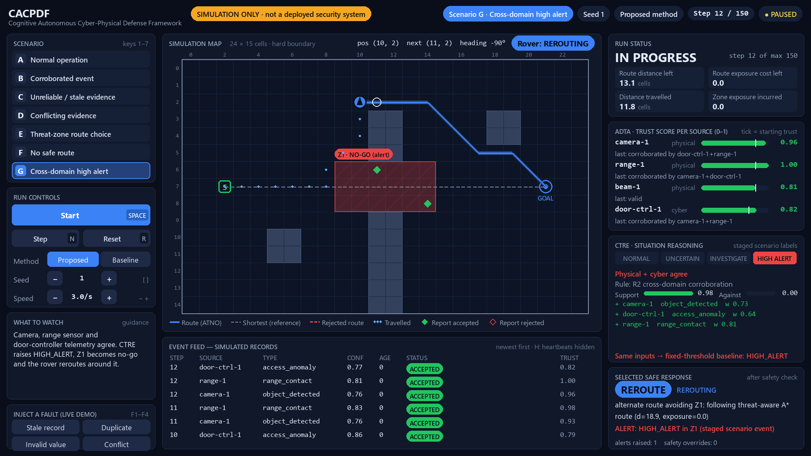
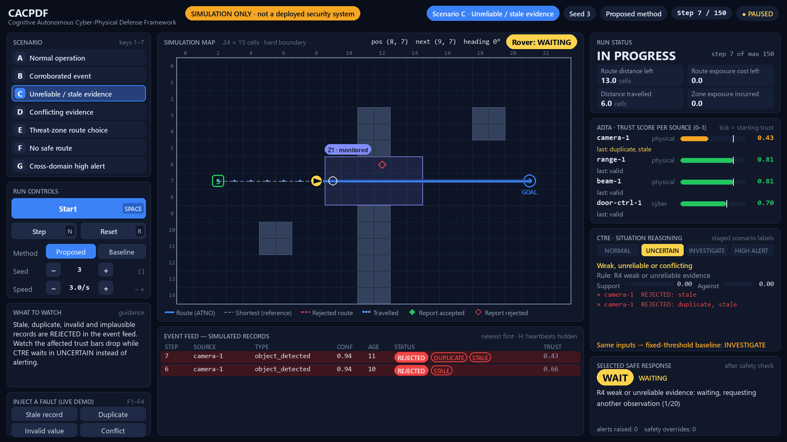

# CACPDF: simulation proof of concept

**Cognitive Autonomous Cyber-Physical Defense Framework.** This is a software-only Python and
Pygame 2D simulation of a rover. The rover receives simulated physical observations and simulated
cyber-telemetry records and processes them in this order:

1. Fuses the evidence.
2. Scores how far each source can be trusted (**ADTA**).
3. Reasons about the staged scenario state (**CTRE**).
4. Plans a route that accounts for exposure (**ATNO**).
5. Takes a safety-checked action.
6. Logs everything for evaluation against a fixed-threshold baseline.

> **This is a simulation proof of concept, not a deployed security system.**
>
> * All sensor and cyber events are generated by scripted, seeded scenarios.
> * No real network is scanned and no external action is taken.
> * No video or face recognition is used.
> * The "events" are abstract staged-scenario labels, not judgments about people.
>
> Nothing here establishes real-world security capability, novelty or performance.



## Requirements and setup

* Python 3.10 or newer. Tested with 3.10.11 on Windows 11.
* `pygame` 2.x. Tested with 2.6.1.
* `matplotlib` is optional. It is used only for the results plot.

```bash
python -m venv .venv
```

Activate the environment. On Windows use `.venv\Scripts\activate`; on macOS/Linux use
`source .venv/bin/activate`. Then install the dependencies:

```bash
pip install -r requirements.txt
```

## Running

| What | Command |
|---|---|
| Open the GUI | `python main.py` (or `python -m cacpdf gui --scenario B --seed 3`) |
| List scenarios | `python -m cacpdf list` |
| One headless run, printing each step | `python -m cacpdf run --scenario C --seed 3 -v` |
| Same inputs, baseline method | `python -m cacpdf run --scenario C --seed 3 --method baseline` |
| Full evaluation (held-out seeds) | `python -m cacpdf evaluate --split eval` |
| Calibration split | `python -m cacpdf evaluate --split calib` |
| Override thresholds | `python -m cacpdf --config my.json run --scenario D` (partial JSON, e.g. `{"ctre": {"escalate_persist": 3}}`) |
| Tests | `python -m unittest discover -s tests -v` |

### GUI layout (presentation dashboard)

The window is a dark control-room dashboard drawn on a fixed 1920×1080 canvas. It is scaled to
fit the window, so the layout is the same on a laptop and on a projector. Press `F11` for
fullscreen. Every value on screen is read from the running simulation.



| Area | What it shows |
|---|---|
| **Top bar** | A filled amber "Simulation only" badge, plus current scenario, seed, method, step counter and run status (READY / RUNNING / PAUSED / DONE). A banner on the map confirms every scenario load, reset, method change and seed change. |
| **Left: Scenario** | Scenarios A–G as a list. The selected one is highlighted. |
| **Left: Run controls** | Start/Pause, Step, Reset, a Proposed/Baseline method switch, seed − / + and speed − / +. Each control shows its keyboard key. |
| **Left: What to watch** | A short note on what the audience should notice in this scenario. This is guidance text, not data. The pre-written expected behaviour is checked in the response panel when the run ends. |
| **Left: Inject a fault** | Stale record, duplicate, invalid value or conflict, injected into the live run. The run is then marked as manually injected. |
| **Centre: Map** | Grid with axis labels and a hard-boundary frame, plus obstacles, start `S`, `GOAL`, zone Z1 and its status tag. |
| **Map: Rover** | Rover with heading arrow, next-waypoint ring, mode, position and heading. |
| **Map: Routes** | Blue line: planned route. Dashed grey line: the obstacle-only shortest path, for reference. Dashed red line: a rejected unsafe route. Dots: cells travelled. |
| **Map: Reports and overlays** | Markers for recent reports (green = accepted, red outline = rejected). The legend under the map covers route lines and report markers; zone types are labelled on the map itself. Overlays show ready, GOAL REACHED and SAFE STOP with the reason. |
| **Centre: Event feed** | Each simulated record with arrival step, source, type, confidence, age at arrival (in steps) and the source's trust after the update. The source timestamp and zone are in the run log. Rejected rows are tinted red with STALE / DUPLICATE / INVALID / IMPLAUSIBLE badges; delayed and missing records get amber badges. |
| **Right: Run status** | Outcome, plus route distance and route exposure cost as separate values (remaining, or planned before the first step). Also distance travelled and zone exposure incurred. |
| **Right: ADTA** | One 0–1 trust bar per source. The tick marks starting trust. The last update reason is shown in plain words (for example "disagrees with range-1 (no penalty)") and turns amber for a penalty or a disagreement. Bookkeeping codes such as the probation and rise cap appear only in the run log. |
| **Right: CTRE** | State ladder, a plain-language meaning, the rule that fired, and support vs against scores. The evidence list marks supporting (+), conflicting (−), rejected (×) and silent (?) sources. It also shows what the other method decides on the same inputs. |
| **Right: Selected safe response** | The action after the safety check, its reason, any alert or safety override, and at the end whether the outcome matched the scenario's expected behaviour. |

**Baseline mode:**
- The CTRE panel becomes "Baseline · fixed confidence threshold", and UNCERTAIN is marked n/a.
- The ADTA panel and the event-feed flags are labelled as not used by the baseline. They are still computed so the two methods can be compared.

### Keyboard

| Key | Action |
|---|---|
| `SPACE` | Start / pause |
| `N` | Single step |
| `R` | Reset (same seed, so the run replays exactly) |
| `1`–`7` | Scenario A–G |
| `M` | Toggle proposed / baseline (resets the run) |
| `[` / `]` | Seed − / + |
| `-` / `+` | Speed |
| `F1`–`F4` | Inject stale / duplicate / invalid / conflict |
| `H` | Show or hide status heartbeats in the event feed |
| `L` | Save the log now |
| `F11` | Toggle fullscreen |
| `ESC` | Leave fullscreen, or quit |

Logs are saved automatically to `results/gui_runs/` when a run ends. A run that had faults
injected by hand records `manual_injections > 0` and is no longer a pure seeded replay.

## Scenarios

Each scenario is seeded and deterministic. The proposed and baseline methods receive identical event records.

| Key | Scenario | Setup | Expected behaviour (written before evaluation) |
|---|---|---|---|
| A | Normal operation | Clear route. A single camera blip (confidence 0.35–0.75) occurs in about 35% of seeds. | Reach the goal with no alert. A brief UNCERTAIN is allowed. |
| B | Corroborated event | Camera and range sensor report a staged marker in Z1. In about 15% of seeds the range sensor is occluded. | INVESTIGATE or higher, hold at a safe point with a local alert, then resume to the goal. |
| C | Unreliable / stale evidence | Stale replay, duplicate, invalid value, low-confidence, implausible position, delayed and missing records. There is no real event. | Trust of the faulty sources drops. No alert. The rover may wait or stop safely. |
| D | Conflicting evidence | Camera says "object in Z1"; the range sensor explicitly says "Z1 clear". | Expose the disagreement, enter UNCERTAIN, WAIT cautiously, no confirmed alert. |
| E | Threat-zone route choice | The shortest route crosses exposure zone Z1; a longer northern route avoids it. | Take the alternate route and reach the goal with zero exposure. |
| F | No safe route | The northern gap is closed, so the only corridor crosses a high-exposure Z1. | Stop and report why. |
| G | Cross-domain high alert | Camera, range sensor and door-controller telemetry (cyber) all report. | HIGH_ALERT, stop and alert, Z1 becomes no-go, reroute, reach the goal. |

## How it works

[docs/ARCHITECTURE.md](docs/ARCHITECTURE.md) contains the Mermaid data-flow diagram, a description of each module, the event schema and every decision rule with its default value. In short:

* **Fusion** flags each record as `stale`, `delayed`, `duplicate`, `invalid_value` or `implausible`.
  * Rejected records are kept for audit but carry no weight.
  * A silent source is a coverage gap, never "clear".
* **ADTA:** `T = clamp(T + αR − βP − γA, 0, 1)`.
  * Each update has reason codes.
  * Rises are capped and rewards are reduced during a probation period.
  * A single disagreement is not penalised. Repeated disagreement is penalised symmetrically.
  * Evidence weight is `W = T × confidence × freshness`.
* **CTRE** applies an ordered rule table over trust-weighted noisy-OR support (R1 conflict, then R2 cross-domain, R3 corroborated, R4 weak/unreliable, R5 normal). Escalation and de-escalation are filtered to stop flicker.
* **ATNO** runs A* with hard constraints. The cost is `J = distance + 4·exposure` with an exposure limit of 6. If the limit is exceeded, the planner tries the minimum-exposure route, and otherwise stops safely.
* **Safety monitor:** every move is checked against the boundary, obstacles, corner cutting and prohibited cells, and the monitor can override the planner. The only actions are continue, wait, investigate from a safe point, move to a safe point, stop with an alert, reroute, hold and safe stop.
* **Baseline:** a fixed confidence threshold (≥ 0.7) on any positive report, with no trust, freshness, duplicate or conflict handling. It uses an obstacle-only planner.

All thresholds are in [cacpdf/config.py](cacpdf/config.py).

## Logs and results

* **Run logs:** `results/gui_runs/` or `results/runs/`. Each run produces:
  * `<run_id>.json`: run ID, scenario, seed, full config, map, ground truth, raw events, validated observations, every trust update, every step (state, rule, explanation, action, safety override, trust, route metrics), alerts, route history and outcome with expectation checks.
  * `<run_id>_steps.csv` and `<run_id>_trust.csv`.
* **Evaluation:** `results/<split>/` contains:
  * `summary_runs.csv` (one row per run),
  * `trust_faults.csv`,
  * `metrics.json`,
  * `report.md` (tables, failure cases and limitations),
  * `comparison.png`,
  * `sample_logs/` (full logs for the first seed of each scenario and method).

The committed `results/eval/` and `results/calib/` were produced by
`python -m cacpdf evaluate --split eval` and `--split calib` on this code. Re-running these commands regenerates them.

### Preliminary results (held-out `eval` split, 30 seeds × 7 scenarios × 2 methods = 420 runs)

These are taken from [results/eval/report.md](results/eval/report.md). They are simulation-only
and preliminary. Scenarios C–G were designed to exercise specific behaviours, so these
numbers reflect those designs and not any real workload.

| Method | TP | FP | FN | TN | Precision | Recall | F1 |
|---|---|---|---|---|---|---|---|
| Proposed (ADTA + CTRE + ATNO) | 59 | 0 | 1 | 150 | 1.000 | 0.983 | 0.992 |
| Fixed-threshold baseline | 60 | 62 | 0 | 88 | 0.492 | 1.000 | 0.659 |

**Where the proposed method behaved better in these scenarios:**

* No alerts on stale, replayed, invalid or conflicting inputs. In C and D the baseline alerted in 30/30 runs each.
* Zero marked-zone exposure in E. The baseline incurred 6.0.
* A safe stop in F, where the baseline drove through exposure 18.0.
* In G it reached the goal in a mean of 21.5 steps by rerouting, against 36.9 steps for the baseline, which holds.

**Costs and failure cases, also measured:**

* **B, seed 1027:** missed because the range sensor was occluded. With only one source, the rule gives UNCERTAIN and never INVESTIGATE. This is by design: a single uncorroborated source is never escalated.
* **Detection latency:** about 1 step longer than the baseline because of the persistence filter.
* **Time spent waiting:** about 17–18 steps in UNCERTAIN on average in C and D.
* **Longer routes:** 23–24 cells instead of 19 in E and G.
* **Penalties on a healthy source:** the symmetric disagreement rule penalised the healthy range sensor in D (102 penalty events, 0.03 each).
* **What ADTA cannot see:** it cannot tell a well-formed false report (D's camera) is false from the record alone.

## Repository layout

```
cacpdf/          simulation package (see docs/ARCHITECTURE.md)
tests/           unittest suite (fusion, ADTA, CTRE, ATNO, safety, determinism, logging)
docs/            architecture/decision rules + GUI screenshots
results/         evaluation outputs (calib + eval); per-run GUI/CLI logs are git-ignored
main.py          GUI launcher
requirements.txt
CACPDF_Expected_Demonstration_Output.md   acceptance criteria (input document)
CACPDF_Implementation_Plan.md             longer-term research plan (input document)
```

## Known limitations

* **Simulation only:** this is a 2D grid with one step per cell. There are no rover dynamics, sensor physics, localisation error or real network telemetry.
* **Scripted inputs:** scenario event streams are scripted with random variation. The faults are the ones the generator injects, so the trust rules are tested only against those fault types.
* **Hand-set parameters:** thresholds were set by hand on the calibration seeds (0–19). There was no optimisation, sensitivity analysis or ablation study. In the implementation plan, B0/B1/P1/P2 and the ablations are future work; only the "fixed-threshold vs. full method" comparison is implemented.
* **Coarse metrics:** detection metrics are run-level, with only two event scenarios (B, G) as positives. The sample is small and no statistical significance is claimed.
* **Weak baseline by design:** the comparison baseline is a deliberately simple fixed-threshold detector. Stronger baselines might close much of the gap.
* **No real "request another observation":** this action only waits. No new sensing is triggered.
* **Manual fault injection** in the GUI is a demonstration aid, and those runs are not seeded replays.
* **Dashboard display:** it is designed for a 16:9 screen. On other aspect ratios it is letterboxed, and below about 1280×720 the small text becomes hard to read. Saving a log and showing heartbeats are keyboard-only (`L`, `H`).
* **Single zone:** the dynamic zone cost and the no-go memory use a fixed 40-step window, and only one monitored zone exists.
