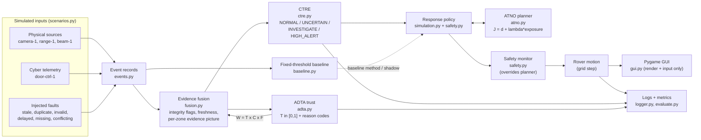

# CACPDF simulation: architecture and decision rules

This document describes the software-only proof of concept in `cacpdf/`. It is a
simulation. No module reads real sensors, touches a real network, or performs
any external action.

## Data flow



Each call to `Simulation.step()` runs the pipeline once in a fixed order:

1. Take the event records whose `arrival_step` is now due.
2. **Fusion** validates each record, flags integrity problems and updates the window of evidence for each zone.
3. **ADTA** updates source trust for each record and penalises sources that have gone silent past the heartbeat timeout.
4. **CTRE** builds a trust-weighted evidence picture for each monitored zone, applies the rule table and the persistence filter, and produces a state. The **baseline** assesses the same records.
5. The **policy** maps the active method's state to an action. **ATNO** plans or replans the route when the cost map has changed.
6. The **safety monitor** validates the motion command and may replace it with a hold.
7. The rover moves at most one cell. Everything is appended to the run log.

## Modules

| Module | Responsibility |
|---|---|
| `config.py` | All thresholds and weights, in dataclasses. JSON overrides are possible with `--config`. A full copy goes into every log. |
| `events.py` | Event schema and the simulated source registry (type and independence group). |
| `world.py` | Grid map from an ASCII layout, zones, neighbours (no corner cutting). |
| `scenarios.py` | Scenarios A–G: map variant, seeded event generator, ground truth and written expected behaviour. |
| `fusion.py` | Integrity checks, freshness, association window, agreement and disagreement relations, per-zone evidence picture. |
| `adta.py` | Trust update rule, reason codes, recovery limits. |
| `ctre.py` | Rule table, persistence filter, explanation text. |
| `baseline.py` | Fixed-threshold detector used for comparison. |
| `atno.py` | A* planner (obstacle-only and threat-aware), exposure limit, minimum-exposure fallback. |
| `safety.py` | Action set, rover modes, safety monitor. |
| `simulation.py` | Orchestrates one step, runs the response policies, holds dynamic zone costs, collects metrics and checks results against expectations. |
| `logger.py` | JSON and CSV export for each run. |
| `evaluate.py` | Batch runs over seed splits, metrics, Markdown report and plot. |
| `gui.py` | Pygame rendering and input. It contains no decision logic. |
| `__main__.py` | CLI (`gui`, `run`, `evaluate`, `list`). |

## Event record

```json
{"event_id": "e0042", "source_id": "camera-1", "event_type": "object_detected",
 "step": 7, "arrival_step": 7, "seq": 12, "confidence": 0.84, "zone_id": "Z1",
 "value": {"cell": [12, 7], "label": "staged-marker"}, "injected_fault": null,
 "source_type": "physical"}
```

`step` is the source's own timestamp, in simulation steps (nominally 0.5 s each).
`injected_fault` is a ground-truth label written by the generator. It is used
only for evaluation and is never read by fusion, ADTA, CTRE or the policy.

## Fusion rules (`FusionConfig`)

| Check | Rule | Effect |
|---|---|---|
| duplicate | `(source, seq)` seen before | rejected; never counted twice |
| invalid_value | confidence outside [0, 1], unknown source/type/zone, range distance outside [0.05, 6] m, negative counter, or a timestamp in the future | rejected |
| implausible | reported cell outside the map, inside an obstacle, or outside the claimed zone | rejected |
| stale | age at arrival > 4 steps | rejected |
| delayed | age at arrival > 2 steps | accepted, with reduced freshness |
| missing | no message from a source for > 8 steps | source listed as a coverage gap; this is **never** treated as "zone clear" |

Freshness is `F = 1` for ages up to 2 steps and `exp(-(age-2)/3)` after that. A
record leaves the picture after 6 steps. Only explicit `zone_clear` reports count
as negative evidence.

## ADTA: trust update (`ADTAConfig`)

```
T_i(t) = clamp(T_i(t-1) + alpha*R_i(t) - beta*P_i(t) - gamma*A_i(t), 0, 1)     alpha = beta = gamma = 1
```

* **R (reward):** `+0.004` for each valid record, plus `+0.03` when an independent source currently agrees.
  * For 12 steps after a penalty, rewards are multiplied by 0.25 (probation).
  * Total rise per step is capped at 0.03.
* **P (penalty):** the sum over the record's flags: stale 0.15, invalid_value 0.25, implausible 0.20, duplicate 0.08, delayed 0.03, missing 0.04.
* **A (disagreement):**
  * A single disagreement is only **recorded**, with no penalty.
  * The same pair disagreeing on every 3rd step of conflict costs **both** sources 0.03. The penalty is symmetric and does not pick a side.
  * A source contradicted by at least 2 agreeing independent sources, with none supporting it, loses 0.05.
* **Evidence weight:** `W = T_source x confidence x freshness`.
* **Initial trust:** camera/range/beam 0.80, door controller 0.70.
* **Audit trail:** every update is logged with before, after, delta and reason codes.

## CTRE rule table (`CTREConfig`)

For each monitored zone the engine computes two noisy-OR scores over the latest
accepted record from each source:

* `S_pos = 1 - prod(1 - W)` over positive reports.
* `S_neg = 1 - prod(1 - W)` over explicit clear reports.

A **supporter** is a source with `W >= 0.25`.

| Rule | Condition | Raw state |
|---|---|---|
| R1 conflict | `S_pos >= 0.30` and `S_neg >= 0.30` | UNCERTAIN |
| R2 cross-domain | 3 or more supporters, `S_pos >= 0.85`, physical **and** cyber supporters | HIGH_ALERT |
| R3 corroborated | 2 or more supporters, `S_pos >= 0.60` | INVESTIGATE |
| R4 weak or unreliable | `S_pos >= 0.20`, or a rejected positive report arrived within the last 2 steps | UNCERTAIN |
| R5 | otherwise | NORMAL |

The **persistence filter** prevents flicker. Escalating requires the new raw state
for 2 consecutive steps. De-escalating requires 4. The explanation lists the
rule that fired, every supporting and conflicting item with its T, C, F and W,
the rejected records with their flags, the coverage gaps and any pending
transition.

The states describe the staged scenario label ("staged-marker"), not people or
real-world threats.

## Response policy and safety

| CTRE state | Action |
|---|---|
| NORMAL | `CONTINUE` along the route. If dynamic costs changed the route, the action is shown as `REROUTE`. |
| UNCERTAIN | `WAIT` and request another observation. After 20 consecutive steps: `SAFE_STOP`. |
| INVESTIGATE | `INVESTIGATE`: hold at a safe observation point outside the zone and raise a local alert. If the rover is inside the zone, `MOVE_TO_SAFE_POINT` first. The zone gets +1.0 dynamic exposure for 40 steps. |
| HIGH_ALERT | `STOP_ALERT` on entry. The zone becomes no-go for 40 steps. Then `REROUTE` via an alternate route, or `SAFE_STOP` if none exists. |
| no safe route / 150-step limit | `SAFE_STOP` with the reason |

The baseline policy is simpler: on an alert it uses `STOP_ALERT` and holds;
otherwise it uses `CONTINUE` on the obstacle-only route.

The **safety monitor** checks every motion command after the policy. It rejects
any move that:

* leaves the map,
* enters an obstacle,
* cuts a corner,
* moves more than one cell, or
* enters a prohibited cell.

Exiting a prohibited zone is allowed. A rejected move becomes `HOLD`, and the
override is logged. No action pursues, confronts or intercepts anything.

## ATNO cost (`ATNOConfig`)

```
J(path) = 1.0 * distance + 4.0 * exposure        exposure = sum(exposure(cell) * step_length)
```

* **Hard constraints** come first: boundary, obstacles, prohibited cells and no corner cutting.
* **Exposure limit:** if the cost-optimal route has exposure above 6.0, the planner also searches for the minimum-exposure route. If that is still above 6.0, no safe route exists and the rover stops with the numbers in the reason.
* **Baseline planner:** uses `J = distance` and ignores exposure.
* **Reporting:** distance and exposure are always reported separately.

## Evaluation method

* **Seed splits:**
  * `calib` (0–19) was used while setting thresholds by hand.
  * `eval` (1000–1029) was run after the configuration was frozen.
* **Identical inputs:** event streams do not depend on rover behaviour, so the proposed and baseline methods receive identical inputs for each scenario and seed. This is verified by hashing the event list.
* **Detection metrics:** run-level TP/FP/FN/TN, where "alert" means INVESTIGATE or HIGH_ALERT. UNCERTAIN time is reported separately as a cost.
* **Expected-behaviour checks:** written in `scenarios.py` before the evaluation. Failures are listed in the report and are not removed.
