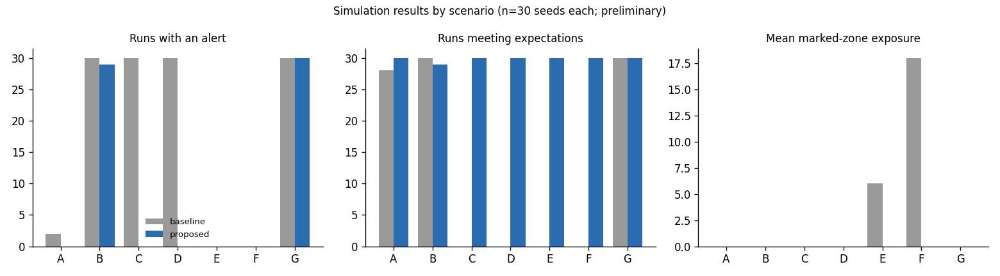

# CACPDF evaluation report — split `eval`

> **Preliminary, simulation-only results.** Generated automatically by `python -m cacpdf evaluate` from runs executed at generation time. 30 seeds per scenario per method (seeds 1000–1029). Event streams are synthetic; these numbers say nothing about real-world sensors, networks or security performance. Scenario C–G inputs were designed to exercise specific behaviours, so results reflect those designs, not a representative workload. No statistical significance is claimed.

Identical event inputs for both methods verified by hash: **yes** (210 scenario/seed pairs).

## Pooled run-level detection (all scenarios)

Positive = scenario ground truth has a staged event (B, G). Predicted positive = any INVESTIGATE/HIGH_ALERT during the run.

| method | runs | TP | FP | FN | TN | precision | recall | f1 |
|---|---|---|---|---|---|---|---|---|
| proposed | 210 | 59 | 0 | 1 | 150 | 1.0 | 0.983 | 0.992 |
| baseline | 210 | 60 | 62 | 0 | 88 | 0.492 | 1.0 | 0.659 |

## Per scenario and method

| scenario | method | runs | alert_runs | high_alert_runs | FP | FN | expected_met | goal_rate | safe_stops | steps_mean | steps_sd | distance_mean | static_exposure_mean | event_zone_steps_mean | uncertain_steps_mean | latency_mean | collisions |
|---|---|---|---|---|---|---|---|---|---|---|---|---|---|---|---|---|---|
| A | baseline | 30 | 2 | 0 | 2 | 0 | 28 | 1.0 | 0 | 19.4 | 1.522 | 19.0 | 0.0 | 0 | 0 |  | 0 |
| A | proposed | 30 | 0 | 0 | 0 | 0 | 30 | 1.0 | 0 | 20.9 | 3.209 | 19.0 | 0.0 | 0 | 1.9 |  | 0 |
| B | baseline | 30 | 30 | 29 | 0 | 0 | 30 | 1.0 | 0 | 35.333 | 1.47 | 19.0 | 0.0 | 0 | 0 | 0 | 0 |
| B | proposed | 30 | 29 | 0 | 0 | 1 | 29 | 1.0 | 0 | 39.4 | 2.175 | 23.907 | 0.0 | 0.1 | 0.533 | 1.207 | 0 |
| C | baseline | 30 | 30 | 7 | 30 | 0 | 0 | 1.0 | 0 | 34.533 | 3.371 | 19.0 | 0.0 | 0 | 0 |  | 0 |
| C | proposed | 30 | 0 | 0 | 0 | 0 | 30 | 1.0 | 0 | 36.233 | 3.287 | 19.0 | 0.0 | 0 | 17.233 |  | 0 |
| D | baseline | 30 | 30 | 0 | 30 | 0 | 0 | 1.0 | 0 | 35.2 | 1.424 | 19.0 | 0.0 | 0 | 0 |  | 0 |
| D | proposed | 30 | 0 | 0 | 0 | 0 | 30 | 1.0 | 0 | 37.067 | 1.413 | 19.0 | 0.0 | 0 | 18.067 |  | 0 |
| E | baseline | 30 | 0 | 0 | 0 | 0 | 0 | 1.0 | 0 | 19 | 0.0 | 19.0 | 6.0 | 0 | 0 |  | 0 |
| E | proposed | 30 | 0 | 0 | 0 | 0 | 30 | 1.0 | 0 | 19 | 0.0 | 23.142 | 0.0 | 0 | 0 |  | 0 |
| F | baseline | 30 | 0 | 0 | 0 | 0 | 0 | 1.0 | 0 | 19 | 0.0 | 19.0 | 18.0 | 0 | 0 |  | 0 |
| F | proposed | 30 | 0 | 0 | 0 | 0 | 30 | 0.0 | 30 | 1 | 0.0 | 0.0 | 0.0 | 0 | 0 |  | 0 |
| G | baseline | 30 | 30 | 30 | 0 | 0 | 30 | 1.0 | 0 | 36.867 | 1.224 | 19.0 | 0.0 | 0 | 0 | 0 | 0 |
| G | proposed | 30 | 30 | 30 | 0 | 0 | 30 | 1.0 | 0 | 21.5 | 1.358 | 23.982 | 0.0 | 0 | 0 | 1 | 0 |

Columns: `expected_met` = runs meeting every pre-written expectation check for the scenario; `static_exposure_mean` = marked-zone exposure actually incurred; `event_zone_steps_mean` = steps spent inside the event zone while the staged event was active (ground truth); `latency_mean` = steps from event onset to first alert; `uncertain_steps_mean` = steps spent in UNCERTAIN (a cost of caution).

## ADTA trust change after injected faults (proposed runs)

Trust of the affected source immediately before/after the update triggered by the faulty record, and 10 steps later.

| fault | updates | trust_before_mean | trust_after_mean | delta_mean | trust_after_10_steps_mean |
|---|---|---|---|---|---|
| delayed | 30 | 0.809 | 0.783 | -0.026 | 0.763 |
| duplicate | 30 | 0.658 | 0.428 | -0.23 | 0.43 |
| false_detection | 336 | 0.78 | 0.773 | -0.007 | 0.735 |
| implausible_position | 30 | 0.436 | 0.236 | -0.2 | 0.238 |
| invalid_value | 30 | 0.712 | 0.462 | -0.25 | 0.464 |
| low_confidence | 30 | 0.817 | 0.821 | 0.004 | 0.831 |
| missing | 28 | 0.784 | 0.744 | -0.04 | 0.744 |
| spurious_detection | 9 | 0.812 | 0.816 | 0.004 | 0.825 |
| stale_replay | 30 | 0.807 | 0.657 | -0.15 | 0.43 |

Note: `false_detection` (D) and `spurious_detection` (A) records are well-formed; ADTA cannot see they are false from the record alone. Their trust effect comes only from disagreement handling or is positive (valid-record reward).

## Trust penalties on records without an injected-fault label

These are penalties applied to records the generator did not label as faulty (e.g. symmetric repeated-disagreement penalties on the healthy side of a conflict).

| scenario | source_id | reason | count | total_delta |
|---|---|---|---|---|
| D | range-1 | repeated_disagreement:camera-1 | 102 | -3.06 |

## Failure cases (runs not meeting the scenario's expected behaviour)

| scenario | method | failed_checks | runs | example | example_final |
|---|---|---|---|---|---|
| A | baseline | alert | 2 | A_baseline_seed1013 | ARRIVED: goal reached |
| B | proposed | alert | 1 | B_proposed_seed1027 | ARRIVED: goal reached |
| C | baseline | alert | 23 | C_baseline_seed1001 | ARRIVED: goal reached |
| C | baseline | alert, no_high_alert | 7 | C_baseline_seed1000 | ARRIVED: goal reached |
| D | baseline | alert | 30 | D_baseline_seed1000 | ARRIVED: goal reached |
| E | baseline | static_exposure | 30 | E_baseline_seed1000 | ARRIVED: goal reached |
| F | baseline | goal, safe_stop, static_exposure | 30 | F_baseline_seed1000 | ARRIVED: goal reached |

## Limitations

- Software-only simulation with synthetic, scripted event streams.
- Thresholds were hand-set on the calibration split; no optimisation or sensitivity study was performed.
- Run-level detection metrics with few positive scenarios; small N.
- The baseline is deliberately simple (fixed threshold, no integrity checks).
